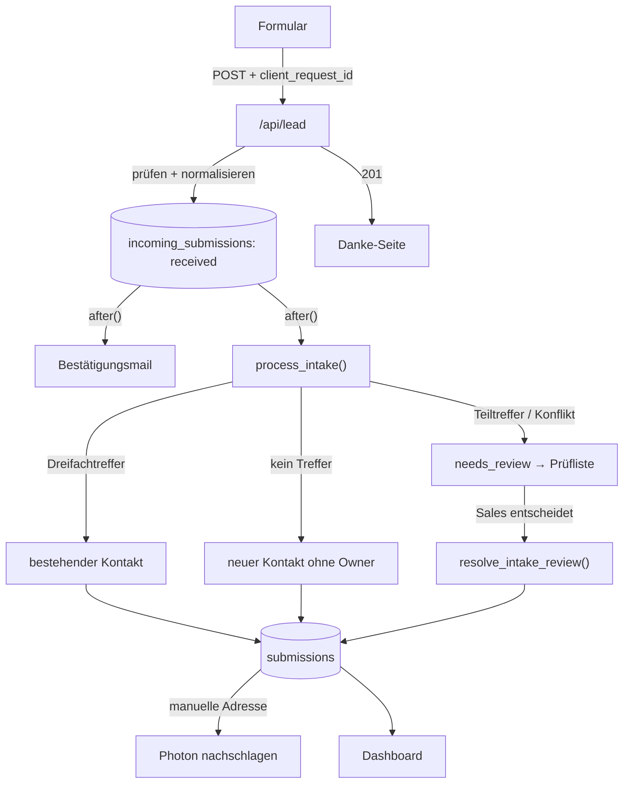
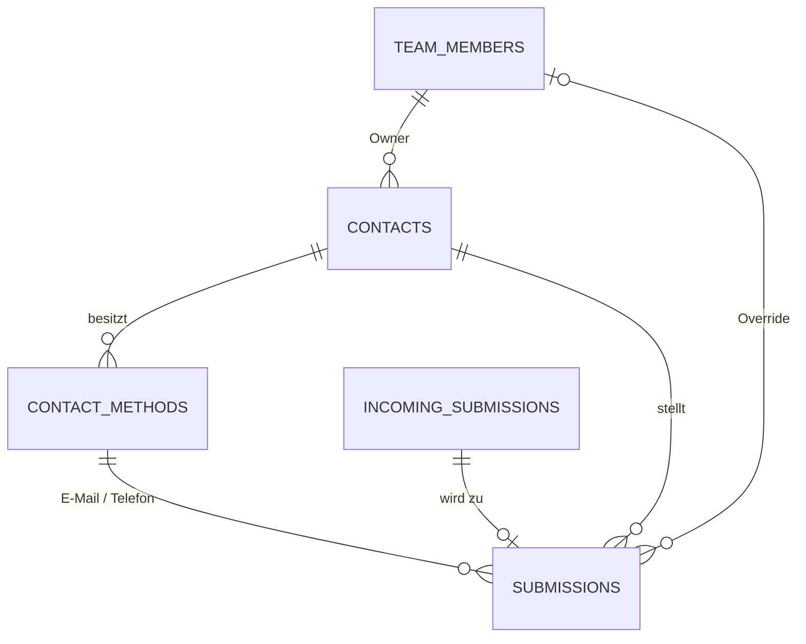

# Planeco Standort-Check – Datenmodell Kontakt ↔ Anfrage

**Spezifikation v3 · Stand 17. Oktober 2026 · Branch `feat/contact-data-model`**

Baut auf v2 auf (`planeco_sales_dashboard_mvp_spezifikation_v2.md`, nicht im Repo) und passt sie an den Case und den
bestehenden Code an. **v3 ist maßgeblich.** Nichts davon ist umgesetzt.

> **Leseregel:** **VERBINDLICH** = mit Michel entschieden. **EMPFEHLUNG** = technische Ausgestaltung, darf beim Umsetzen
> angepasst werden (Abweichung im HANDOVER notieren). **BACKLOG** = nicht vorziehen. **OFFEN** = nicht raten, nachfragen.

---

## 0. Kurzfassung

Wir ersetzen die flache Tabelle `leads` durch ein kontaktorientiertes Modell. Mehrere Anfragen derselben Person landen
unter **einem** Kontakt; jede Anfrage bleibt eine eigene Submission mit eigenem Grundstück, eigener Kampagne und eigenem
Ergebnis. So sieht Sales, wer schon betreut wird, und doppelte Arbeit fällt weg.

**Fünf Tabellen:** `team_members`, `contacts`, `contact_methods`, `incoming_submissions`, `submissions`.

**Ablauf beim Absenden:**

1. Server prüft und normalisiert (Telefon → E.164, E-Mail → lowercase).
2. Server speichert den Eingang in `incoming_submissions` (`received`) und antwortet sofort.
3. Danach, im selben Aufruf per `after()`: Bestätigungsmail senden **und** Eingang verarbeiten.
4. Verarbeitung (eine Datenbankfunktion, eine Transaktion):
   - eindeutiger Treffer bei Name + E-Mail + Telefon → bestehender Kontakt, neue Submission;
   - kein Treffer bei E-Mail und Telefon → neuer Kontakt (ohne Owner), neue Submission;
   - alles andere → `needs_review`, noch **keine** Submission. Ein Mensch entscheidet.
5. Manuell eingegebene Adressen werden danach über Photon nachgeschlagen (Gemeinde, Kreis, Bundesland, Koordinaten).
6. Bricht etwas ab, bleibt der Eingang erhalten. Das Dashboard zeigt ihn an, „Erneut verarbeiten“ holt ihn nach.

**Kein eigener Worker, keine Queue.** Das ist die bewusste Abkürzung gegenüber v2 (siehe §6).

---

## 1. Entscheidungen

| Thema | Beschluss | Status | Warum |
|---|---|---|---|
| Zentrales Objekt im Dashboard | Kontakt, Anfragen darunter aufklappbar | VERBINDLICH | Sales spricht mit einer Person. |
| Schlüssel | Jede Tabelle eigene UUID | VERBINDLICH | Name, Mail und Telefon ändern sich. |
| Mehrere Anfragen einer Person | Ein Kontakt → viele Submissions | VERBINDLICH | Grundstück, Kampagne, Ergebnis gehören zur Anfrage. |
| E-Mails/Telefone | Eigene Tabelle `contact_methods` | VERBINDLICH | Beliebig viele je Kontakt, keine Listen in Zellen. |
| Submission verweist auf Methoden | `email_method_id`, `phone_method_id` statt Textkopie | VERBINDLICH | Nachvollziehbar, welche Angabe genutzt wurde. |
| Eingangstabelle | **Jeder** Eingang zuerst in `incoming_submissions` | VERBINDLICH | Nichts geht verloren, auch wenn Matching scheitert. |
| Auto-Match | Nur eindeutiger Dreifachtreffer (Name + Mail + Telefon) | VERBINDLICH | Keine riskanten Teiltreffer. |
| Teiltreffer, Konflikte | Prüfliste, jeder Sales-Mitarbeiter darf entscheiden | VERBINDLICH | Ehepartner, Tippfehler, geteilte Nummern. |
| Wer geprüft hat | **Nicht** speichern (kein `reviewed_by`) | VERBINDLICH | Von Michel so gewünscht. |
| Neuer Kontakt | Ohne Owner → gemeinsame Inbox „Nicht zugewiesen“, manuelle Übernahme | VERBINDLICH | Kein Gebietsrouting nötig. |
| Bekannter Kontakt | Neue Anfrage geht an den bestehenden Owner | VERBINDLICH | Beziehung bleibt bei einer Person. |
| Abweichender Bearbeiter | Optionaler Override pro Submission | VERBINDLICH | Sonderfälle ohne Owner-Wechsel. |
| Bearbeitungsstatus | `open`, `contacted`, `completed`; nur `completed` zählt als fertig | VERBINDLICH | Bedeutung von `contacted` bewusst offen. |
| Ergebnis | `outcome` an der **Submission**: `qualified`, `not_qualified`, `unreachable`, optional | VERBINDLICH | Case Pflicht 6: „welche Kampagnen etwas taugen“. Kampagne und Ergebnis am selben Datensatz. |
| Tracking | 5 × UTM, `gclid`, `fbclid`, `landing_page`, `referrer` an der Submission | VERBINDLICH | Herkunft je Anfrage, auch ohne UTM. |
| Einzugsgebiet | Alle 16 Bundesländer, als Liste im Code; Anzeige wird berechnet | VERBINDLICH | Später einfach einschränkbar. |
| Adress-Anreicherung | Photon-Vorschlag direkt, manuelle Adresse serverseitig nachschlagen | VERBINDLICH | Erweiterung des Case. |
| Telefon im Formular | Länder-Dropdown (Standard +49), nur Ziffern, `libphonenumber-js` | VERBINDLICH | Format schon bei der Eingabe richtig. |
| Prüffälle im Dashboard | Nur in `incoming_submissions`; Hinweis mit Link + Export mit Vermerk | VERBINDLICH | Nichts doppelt speichern, nichts übersehen. |
| Verarbeitung | `after()` + „Erneut verarbeiten“, kein Worker | VERBINDLICH | Vercel Hobby hat nur tägliche Crons. |
| Gleichzeitige Erst-Eingänge | Advisory Lock auf normalisierte Mail und Telefon | VERBINDLICH | Sonst zwei Kontakte für dieselbe Person. |
| Sichtbarkeit | Alle Sales-Mitarbeiter sehen alle Anfragen | VERBINDLICH | Case: „sieht alle eingegangenen Anfragen“. |
| Alte `leads`-Daten | Nicht übernehmen | VERBINDLICH | Nur Testdaten. |
| Geo-Routing, Submission-Merge, Projekte, Fuzzy-Matching, Notizen | – | BACKLOG | Siehe §12. |

### Abweichungen von v2 (am Code entschieden)

| v2 | v3 | Grund |
|---|---|---|
| Postgres-Enums | `text` + `check` | Wie in `001`/`003`; leichter zu ändern. |
| Status `processing`, Lease, Worker | entfallen | Verarbeitung ist eine einzige Transaktion (§6). |
| `country_code` | entfällt | Formular nimmt nur deutsche Adressen (Photon DE, PLZ 5-stellig). |
| Adressfelder optional | Pflicht | Formular und `001` verlangen sie heute schon. |
| `email_method_id`, `phone_method_id` optional | Pflicht | Beides ist Pflichtfeld (Mail für Bestätigung, Telefon für Sales). |
| `team_members.email`, `role` | entfallen | E-Mail steht in `auth.users`; alle Nutzer haben im MVP dieselben Rechte. |
| `contact_methods.is_primary`, `is_active` | entfallen | Keine UI dafür im MVP; „zuletzt genutzt“ wird aus den Submissions berechnet. |
| `raw_payload` = Request-Body | `payload` = geprüfte zod-Daten + normalisierte Spalten | Keine fremden Felder in der DB; Matching läuft komplett in SQL. |
| Normalisierung im Worker | Normalisierung in der API vor dem Speichern | Ungültige Telefonnummern werden sofort mit 422 abgewiesen. |

---

## 2. Ablauf im Überblick





---

## 3. Tabellen

### 3.1 `team_members`

| Feld | Typ | Zweck |
|---|---|---|
| `id` | uuid PK | Interne ID. |
| `auth_user_id` | uuid UNIQUE NOT NULL → `auth.users` | Verknüpfung zum Login. |
| `display_name` | text NOT NULL | Anzeige im Dashboard, z. B. „Max“. |
| `created_at` | timestamptz | |

Zeilen werden von Hand angelegt (SQL), passend zu den Supabase-Nutzern. Selbstregistrierung bleibt aus.

### 3.2 `contacts`

| Feld | Typ | Zweck |
|---|---|---|
| `id` | uuid PK | Stabile `contact_id`. |
| `first_name`, `last_name` | text NOT NULL | Bevorzugter Name, von Sales korrigierbar. |
| `account_owner_id` | uuid NULL → `team_members` | `NULL` = noch nicht übernommen. |
| `created_at`, `updated_at` | timestamptz | |

**Nicht hier:** E-Mail, Telefon, Adresse, Tracking, Zähler, Fortschritt. Alles abgeleitet oder an der Submission.

### 3.3 `contact_methods`

| Feld | Typ | Zweck |
|---|---|---|
| `id` | uuid PK | `method_id`. |
| `contact_id` | uuid NOT NULL → `contacts` | |
| `type` | text `email` / `phone` | |
| `normalized_value` | text NOT NULL | E-Mail lowercase, Telefon E.164 (`+4940123456`). |
| `created_at` | timestamptz | |

- `UNIQUE (contact_id, type, normalized_value)`, Index auf `(type, normalized_value)` fürs Matching.
- **Kein** globales Unique: Ehepartner dürfen sich Mail oder Telefon teilen.
- `UNIQUE (contact_id, id)` als Ziel für den zusammengesetzten Fremdschlüssel aus `submissions`.
- Werte sind **unveränderlich** (Trigger). Neue Nummer → neue Zeile.

### 3.4 `incoming_submissions`

Jeder gültige Eingang, **bevor** gematcht wird. Technische Tabelle, kein Backup.

| Feld | Typ | Zweck |
|---|---|---|
| `id` | uuid PK | `intake_id`. |
| `client_request_id` | uuid UNIQUE NOT NULL | Idempotenz: gleicher Absendevorgang → gleicher Eingang. |
| `payload` | jsonb NOT NULL | Geprüfte Formulardaten (zod-Ausgabe, unbekannte Felder entfernt), inkl. Tracking. |
| `normalized_email` | text NOT NULL | Für Matching und Lock. |
| `normalized_phone` | text NOT NULL | E.164. |
| `status` | text `received` / `needs_review` / `processed` / `failed` | Verarbeitungszustand, **nicht** Sales-Status. |
| `received_at` | timestamptz | Eingangszeit = fachliche Zeit der Anfrage. |
| `processed_at` | timestamptz NULL | Gesetzt genau bei `processed`. |
| `attempt_count` | int | Anzahl Verarbeitungsversuche. |
| `last_error` | text NULL | Technischer Grund, ohne Personendaten. |
| `confirmation_status` | text `pending` / `sent` / `failed` | Bestätigungsmail (bisher in `leads`). |
| `confirmation_sent_at` | timestamptz NULL | |
| `confirmation_error` | text NULL | |
| `updated_at` | timestamptz | |

**Warum die Mail hier hängt:** Die Mail geht pro Eingang raus, auch wenn er noch geprüft werden muss.

**Zustände:** `received` → `processed` oder `needs_review` oder `failed`. `failed` → erneuter Versuch.
`needs_review` → `processed` nach der Prüfung. `processed` ist endgültig.

### 3.5 `submissions`

Eine Zeile = eine einem Kontakt zugeordnete Anfrage.

| Bereich | Felder | Hinweise |
|---|---|---|
| Schlüssel | `id` PK, `intake_id` UNIQUE NOT NULL → `incoming_submissions` | 1:1 zum Eingang. |
| Kontakt | `contact_id` NOT NULL, `email_method_id` NOT NULL, `phone_method_id` NOT NULL | Methoden müssen zum selben Kontakt gehören und den richtigen Typ haben. |
| Eingegebener Name | `submitted_first_name`, `submitted_last_name` | Original, auch wenn der Kontaktname später korrigiert wird. |
| Grundstück | `street`, `house_number`, `postal_code`, `city` NOT NULL; `address_source` `photon` / `manual` | Wie heute in `leads`. |
| Anreicherung | `municipality`, `county`, `state`, `latitude`, `longitude` NULL; `geocode_status` | Siehe §5.3. |
| Tracking | `utm_source`, `utm_medium`, `utm_campaign`, `utm_content`, `utm_term`, `gclid`, `fbclid`, `landing_page`, `referrer` | Alle optional, je max. 500 Zeichen. |
| Bearbeitung | `status` (`open` / `contacted` / `completed`), `completed_at`, `outcome` NULL (`qualified` / `not_qualified` / `unreachable`), `assigned_to_override` NULL → `team_members` | `completed_at` genau bei `completed`. |
| Herkunft | `match_status` `auto_matched` / `manually_matched` / `new_contact_created` | Anzeige „automatisch zugeordnet“. |
| Zeit | `created_at` (= `received_at` des Eingangs), `updated_at` | |

**`geocode_status`:** `suggestion` (Adresse aus Photon-Vorschlag, Daten schon da) · `pending` (manuell, noch nicht
nachgeschlagen) · `geocoded` · `not_found` · `failed` (Photon nicht erreichbar, später erneut versuchen).

**`outcome` und `status` sind unabhängig.** `status` sagt, wie weit Sales ist; `outcome` sagt, was die Anfrage wert war.
Keine Regel erzwingen (z. B. „`outcome` nur bei `completed`“), das bleibt der UI überlassen.

---

## 4. Beispiel

`team_members`: Max, Lisa. `contacts`: Thomas Ahrens (Owner Max).
`contact_methods`: `thomas@gmail.com`, `+4940123456`, `+491701234567`.

| Submission | Grundstück | Telefon | status | outcome | Override | Kampagne |
|---|---|---|---|---|---|---|
| 1 | Dresden, Hauptstraße 14 | +4940123456 | completed | not_qualified | – | meta / sommer |
| 2 | Hamburg, Osterstraße 3 | +491701234567 | contacted | – | Lisa | google / brand |
| 3 | Dresden, Hauptstraße 14 | +4940123456 | open | – | – | google / brand |

Dashboard: **Thomas Ahrens · Max · auch Lisa · 1 von 3 abgeschlossen**. Case-Beispiele 1 und 4
(`+49 40 / 123 456` und `004940123456`) ergeben dieselbe E.164-Nummer und werden erkannt.

---

## 5. Formular und API

### 5.1 Formular

- **Telefon:** Dropdown mit Ländervorwahl (Standard 🇩🇪 +49, andere Länder wählbar) und Feld nur für Ziffern.
  Führende `0` wird entfernt (`+49` + `040…` → `+4940…`). Prüfung mit `libphonenumber-js` (`isValidPhoneNumber`).
- **E-Mail:** wie heute (zod `z.email`).
- **Tracking:** Beim ersten Laden aus der URL lesen (`utm_*`, `gclid`, `fbclid`), dazu `landing_page`
  (`location.pathname + search`) und `document.referrer`. In `sessionStorage` halten (EMPFEHLUNG), damit ein Neuladen
  sie nicht verliert. Fehlt `sessionStorage`, einfach ohne weitermachen.
- **`client_request_id`:** Beim ersten Absenden `crypto.randomUUID()`. Wiederholung nach Netzfehler → dieselbe ID.
  Nach Erfolg verwerfen. Neues bewusstes Absenden → neue ID.

### 5.2 API `POST /api/lead`

1. JSON parsen (400), zod-Schema prüfen (422 mit `fieldErrors`). Das Schema bleibt in `lib/lead-schema.ts`.
2. Normalisieren (`lib/normalize.ts`, neu):
   - Telefon: `parsePhoneNumber(...).number` → E.164. Ungültig → 422 am Feld `phone`.
   - E-Mail: `trim().toLowerCase()`. Keine Gmail-Punkt-Tricks.
3. Insert in `incoming_submissions` (`payload`, `normalized_*`, `client_request_id`).
   Konflikt auf `client_request_id` → bestehenden Eingang zurückgeben, nichts neu anlegen, keine zweite Mail.
4. Antwort `201 { ok: true, id: intake_id }`.
5. `after()`: `sendConfirmation(intakeId, …)` und `processIntake(intakeId)`, unabhängig voneinander.
   Ein Fehler im einen darf das andere nicht verhindern.

### 5.3 Adress-Anreicherung

- **Photon-Vorschlag gewählt:** `state`, `latitude`, `longitude` kommen wie heute aus dem Formular.
  `toSuggestion` in `lib/photon.ts` gibt zusätzlich `county` mit; `municipality` = Photon `city`.
  `geocode_status = 'suggestion'`.
- **Manuell eingegeben:** `geocode_status = 'pending'`. Nach dem Anlegen der Submission sucht der Server
  bei Photon nach `Straße Hausnummer, PLZ Ort` (Timeout 5 s, nur DE, nur Typ `house`).
  - Treffer mit gleicher PLZ → Felder füllen, `geocoded`.
  - Kein passender Treffer → `not_found`.
  - Photon-Fehler → `failed`, wird bei „Erneut verarbeiten“ wiederholt.
- Photon-Ausfall blockiert nie das Absenden und nie das Matching.

### 5.4 Einzugsgebiet

`lib/service-area.ts`: Liste `SERVICE_AREA_STATES` mit allen 16 Bundesländern.
Anzeige berechnet: `state` in Liste → „im Gebiet“, `state` NULL → „unbekannt“. **Nicht speichern.**
Das Dashboard zeigt dazu Gemeinde, Kreis und Bundesland. Einschränken = Liste ändern.

---

## 6. Verarbeitung ohne Worker

### 6.1 Warum kein Worker

Ein Worker mit Queue bräuchte Cron oder Queue-Dienst; Vercel Hobby führt Crons nur täglich aus. Stattdessen läuft
die Verarbeitung per `after()` direkt nach der Antwort, so wie heute die Mail. Die Sicherheit kommt aus der
Eingangstabelle: Was nicht verarbeitet wurde, steht dort und ist sichtbar.

### 6.2 `process_intake(intake_id)` – eine Transaktion in SQL

Postgres-Funktion (`security definer`, nur für `service_role` ausführbar), aufgerufen per `supabase.rpc`.
Die Supabase-JS-Bibliothek kann keine Transaktionen über mehrere Aufrufe; deshalb steckt die Logik in SQL.

1. Eingang mit `FOR UPDATE` sperren. Status nicht `received` / `failed` → nichts tun, aktuellen Status zurückgeben.
   (Verhindert, dass `after()` und „Erneut verarbeiten“ doppelt arbeiten. Ein Status `processing` ist dadurch unnötig.)
2. `attempt_count + 1`.
3. **Advisory Locks** auf `email:<normalized_email>` und `phone:<normalized_phone>`
   (`pg_advisory_xact_lock(hashtextextended(key, 0))`, beide Schlüssel in sortierter Reihenfolge).
   Ein zweiter gleichzeitiger Eingang mit derselben Mail oder Nummer wartet, bis der erste fertig ist, und findet dann
   dessen Kontakt.
4. Kandidaten suchen: Kontakt-IDs zur E-Mail, Kontakt-IDs zum Telefon, Vereinigung beider Mengen.
5. Entscheiden (§7). Bei Treffer oder neuem Kontakt: fehlende Methoden anlegen, Submission anlegen,
   Eingang → `processed`. Bei Unklarheit: Eingang → `needs_review`.
6. Fehler → Funktion bricht ab, alles wird zurückgerollt. Die aufrufende TS-Funktion setzt dann
   `status = 'failed'`, `last_error`.

Danach (TS, außerhalb der Transaktion): bei `geocode_status = 'pending'` Photon nachschlagen (§5.3).

### 6.3 „Erneut verarbeiten“

Dashboard zeigt oben, falls vorhanden:
- „**N Anfragen warten auf Prüfung**“ → Link zur Prüfliste.
- „**N Anfragen nicht verarbeitet**“ (`failed`, oder `received` älter als 5 Minuten) → Knopf „Erneut verarbeiten“.

Der Knopf ruft `processIntake` für diese Eingänge auf und wiederholt außerdem `geocode_status = 'failed' / 'pending'`.
Mail-Wiederholung bleibt BACKLOG (offener Punkt aus dem HANDOVER).

---

## 7. Matching-Regeln

Name-Vergleich: `lower(normalize(regexp_replace(trim(name), '\s+', ' ', 'g'), NFC))` für Vor- und Nachname.
Grundstücksadresse ist **kein** Matching-Kriterium.

| Ergebnis | Entscheidung |
|---|---|
| Vereinigung = genau ein Kontakt, der bei Mail **und** Telefon gefunden wurde, Name gleich | **Auto-Match** (`auto_matched`) |
| Mail und Telefon → derselbe Kontakt, Name anders | Prüfung |
| Nur Mail oder nur Telefon gefunden | Prüfung |
| Mail → Kontakt A, Telefon → Kontakt B | Prüfung |
| Mehrere Kontakte teilen Mail oder Telefon | Prüfung |
| Weder Mail noch Telefon gefunden | **Neuer Kontakt** (`new_contact_created`), auch bei gleichem Namen oder Grundstück |

Beim Auto-Match werden die vorhandenen Method-IDs wiederverwendet.

### 7.1 Prüfliste

- Zeigt pro Eingang: Name, Mail, Telefon, Grundstück, Eingangszeit, Kampagne.
- Kandidaten werden **beim Anzeigen neu berechnet** (`intake_candidates(intake_id)`: Kontakt, Owner,
  Mail gleich ja/nein, Telefon gleich ja/nein, Name gleich ja/nein), nicht beim Eingang gespeichert.
- Aktionen: „**Diesem Kontakt zuordnen**“ (optional Kontaktname anpassen) oder „**Neuen Kontakt anlegen**“.
- `resolve_intake_review(intake_id, action, contact_id, first_name, last_name)`:
  - prüft, dass `auth.uid()` ein Team Member ist;
  - sperrt den Eingang, verlangt `needs_review` (sonst Fehler „Bereits bearbeitet“);
  - setzt dieselben Advisory Locks wie §6.2;
  - legt fehlende Methoden an, legt die Submission an (`manually_matched` bzw. `new_contact_created`),
    setzt den Eingang auf `processed`;
  - speichert **nicht**, wer entschieden hat.
- Danach Geocoding wie §5.3.

### 7.2 Zwei Arten von Doppelungen

- **Gleicher Absendevorgang** (Doppelklick, Netz-Retry): gleiche `client_request_id` → ein Eingang, eine Submission.
- **Person füllt bewusst zweimal aus:** zwei Eingänge, zwei Submissions, ein Kontakt. Nicht zusammenführen.

---

## 8. Dashboard

### 8.1 Zuständigkeit

- Effektiver Bearbeiter: `coalesce(s.assigned_to_override, c.account_owner_id)`.
- **Übernehmen:** `claim_contact(contact_id)` setzt den Owner nur, wenn er `NULL` ist. Verliert man das Rennen,
  meldet die UI „Bereits übernommen von …“.
- Owner-Wechsel: Alle Submissions ohne Override wandern mit. Gewollt, so testen.
- Wird ein Team Member gelöscht: `account_owner_id` → `NULL`, der Kontakt erscheint wieder unter „Nicht zugewiesen“;
  Overrides → `NULL`. Gewollt.

### 8.2 Ansichten

Eine Liste mit Filtern statt fünf getrennter Seiten (EMPFEHLUNG):

| Filter | Inhalt |
|---|---|
| Offen (Standard) | Kontakte mit mindestens einer `open`/`contacted`-Submission |
| Nicht zugewiesen | … davon ohne Owner |
| Meine | Kontakte, bei denen ich Owner bin, **oder** Submissions mit mir als effektivem Bearbeiter |
| Alle | auch vollständig abgeschlossene |

Pro Kontakt: Name, Owner, „auch Lisa“, Fortschritt `completed / total`, neueste Anfrage, Hinweis „automatisch zugeordnet“.
Aufgeklappt pro Submission: Grundstück mit Gemeinde/Bundesland und Gebiets-Hinweis, genutzte Mail und Telefon,
Kampagne, Status, Ergebnis, Bearbeiter, Mailstatus.

Sortierung bleibt per Spaltenklick (Whitelist wie heute in `lib/leads.ts`).

Darüber die Hinweise aus §6.3 und die Prüfliste als eigene Seite `/admin/review`.

### 8.3 Fortschritt (nur berechnet)

```text
total     = Anzahl Submissions des Kontakts
completed = davon status = 'completed'
pending   = davon status in ('open', 'contacted')
```

3/3 → Kontakt verschwindet aus „Offen“. Neue Anfrage → 3/4, Kontakt erscheint wieder, Owner bleibt.

### 8.4 Export (CSV)

- Eine Zeile pro Submission: Eingang, Kontakt-ID, Kontaktname, eingegebener Name, Mail, Telefon, Adresse,
  Gemeinde, Kreis, Bundesland, im Gebiet, Koordinaten, alle Tracking-Felder, Status, Ergebnis, Owner,
  effektiver Bearbeiter, Match-Art, Mailstatus.
- **Zusätzlich** Eingänge mit `needs_review`, `failed` oder `received`, Daten aus `payload`,
  Spalte „Verarbeitung“ = „in Prüfung“ / „nicht verarbeitet“. Kontaktspalten leer.
- Bestehende Regeln aus `lib/csv.ts` bleiben: Semikolon, UTF-8 mit BOM, Formel-Schutz.

### 8.5 Rechte

- Lesen im Dashboard über die Session (`lib/supabase/session.ts`), RLS-Policy `select` für `authenticated` auf allen
  fünf Tabellen, wie heute in `002`.
- Schreiben aus dem Dashboard **nur** über Funktionen, die `auth.uid()` gegen `team_members` prüfen:
  `claim_contact`, `set_submission_status`, `set_submission_outcome`, `set_submission_override`,
  `update_contact_name`, `resolve_intake_review`. Keine direkten `update`-Rechte für `authenticated`.
- `process_intake` und alle Inserts von Eingängen nur mit `service_role` (Server).

---

## 9. SQL-Referenz (EMPFEHLUNG)

Datei `supabase/004_contact_model.sql`. **Zusätzlich** zu `leads`, damit die Live-App auf `main` weiterläuft.
`leads` wird erst nach dem Merge gelöscht (`supabase/00X_drop_leads.sql`).

```sql
create table public.team_members (
  id            uuid primary key default gen_random_uuid(),
  auth_user_id  uuid not null unique references auth.users(id) on delete cascade,
  display_name  text not null,
  created_at    timestamptz not null default now()
);

create table public.contacts (
  id               uuid primary key default gen_random_uuid(),
  first_name       text not null,
  last_name        text not null,
  account_owner_id uuid references public.team_members(id) on delete set null,
  created_at       timestamptz not null default now(),
  updated_at       timestamptz not null default now()
);
create index on public.contacts (account_owner_id);

create table public.contact_methods (
  id               uuid primary key default gen_random_uuid(),
  contact_id       uuid not null references public.contacts(id) on delete restrict,
  type             text not null check (type in ('email', 'phone')),
  normalized_value text not null check (length(normalized_value) > 0),
  created_at       timestamptz not null default now(),
  unique (contact_id, type, normalized_value),
  unique (contact_id, id)
);
create index on public.contact_methods (type, normalized_value);

create table public.incoming_submissions (
  id                   uuid primary key default gen_random_uuid(),
  client_request_id    uuid not null unique,
  payload              jsonb not null,
  normalized_email     text not null,
  normalized_phone     text not null,
  status               text not null default 'received'
                         check (status in ('received', 'needs_review', 'processed', 'failed')),
  received_at          timestamptz not null default now(),
  processed_at         timestamptz,
  attempt_count        integer not null default 0 check (attempt_count >= 0),
  last_error           text,
  confirmation_status  text not null default 'pending'
                         check (confirmation_status in ('pending', 'sent', 'failed')),
  confirmation_sent_at timestamptz,
  confirmation_error   text,
  updated_at           timestamptz not null default now(),
  check ((status = 'processed') = (processed_at is not null))
);
create index on public.incoming_submissions (status, received_at);

create table public.submissions (
  id                   uuid primary key default gen_random_uuid(),
  intake_id            uuid not null unique references public.incoming_submissions(id) on delete restrict,
  contact_id           uuid not null references public.contacts(id) on delete restrict,
  email_method_id      uuid not null,
  phone_method_id      uuid not null,
  submitted_first_name text not null,
  submitted_last_name  text not null,

  street               text not null,
  house_number         text not null,
  postal_code          text not null,
  city                 text not null,
  address_source       text not null check (address_source in ('photon', 'manual')),
  municipality         text,
  county               text,
  state                text,
  latitude             double precision check (latitude between -90 and 90),
  longitude            double precision check (longitude between -180 and 180),
  geocode_status       text not null
                         check (geocode_status in ('suggestion', 'pending', 'geocoded', 'not_found', 'failed')),

  utm_source           text check (length(utm_source)   <= 500),
  utm_medium           text check (length(utm_medium)   <= 500),
  utm_campaign         text check (length(utm_campaign) <= 500),
  utm_content          text check (length(utm_content)  <= 500),
  utm_term             text check (length(utm_term)     <= 500),
  gclid                text check (length(gclid)        <= 500),
  fbclid               text check (length(fbclid)       <= 500),
  landing_page         text check (length(landing_page) <= 500),
  referrer             text check (length(referrer)     <= 500),

  status               text not null default 'open' check (status in ('open', 'contacted', 'completed')),
  completed_at         timestamptz,
  outcome              text check (outcome in ('qualified', 'not_qualified', 'unreachable')),
  assigned_to_override uuid references public.team_members(id) on delete set null,
  match_status         text not null
                         check (match_status in ('auto_matched', 'manually_matched', 'new_contact_created')),
  created_at           timestamptz not null,
  updated_at           timestamptz not null default now(),

  check ((status = 'completed') = (completed_at is not null)),
  foreign key (contact_id, email_method_id) references public.contact_methods(contact_id, id) on delete restrict,
  foreign key (contact_id, phone_method_id) references public.contact_methods(contact_id, id) on delete restrict
);
create index on public.submissions (contact_id, status);
create index on public.submissions (assigned_to_override);
```

**Zusätzlich in `004` (Inhalt in der Umsetzung):**

- Trigger: Methoden-Typ passt zur Spalte (`email_method_id` → `email`, `phone_method_id` → `phone`).
  Der zusammengesetzte Fremdschlüssel prüft nur den Kontakt, nicht den Typ.
- Trigger: `contact_methods.contact_id/type/normalized_value` unveränderlich.
- Trigger: `updated_at` auf `contacts`, `incoming_submissions`, `submissions`.
- Funktionen aus §6.2, §7.1 und §8.5, jeweils `security definer` mit `set search_path = public`.
- `alter table … enable row level security` auf allen fünf Tabellen, `grant` an `service_role`,
  `grant select` + Policy `using (true)` an `authenticated` (wie `001`/`002`), `grant execute` gezielt pro Funktion.
- `revoke execute … from public` für alle Funktionen, bevor gezielt freigegeben wird.

---

## 10. Akzeptanztests

### Eingang
- [ ] Gültiges Formular → genau ein Eingang `received`, Antwort erst nach dem Insert.
- [ ] Gleiche `client_request_id` zweimal → ein Eingang, eine Submission, eine Mail.
- [ ] Ungültige Telefonnummer am Formular vorbei an die API → 422, kein Eingang.
- [ ] `process_intake` wirft einen Fehler → Eingang `failed`, Daten vollständig, Hinweis im Dashboard, Knopf holt ihn nach.
- [ ] `after()` und „Erneut verarbeiten“ gleichzeitig → genau eine Submission.
- [ ] Mail wird auch bei `needs_review` verschickt; Mailstatus steht am Eingang.

### Matching
- [ ] Case-Beispiele 1 und 4 (Case nennt keine Mail; beim Test dieselbe Mail eintragen) → ein Kontakt, zweite Anfrage `auto_matched`.
- [ ] Gleiche Mail, neue Nummer → `needs_review`; nach Zuordnung neue Telefon-Methode am Kontakt.
- [ ] Gleiche Nummer, andere Mail und Name (HANDOVER-Fall „Jan Michel Kirsch“ / „Michel Kirsch“) → `needs_review`.
- [ ] Mail von A, Telefon von B → `needs_review`.
- [ ] Zwei Kontakte teilen eine Mail → `needs_review`.
- [ ] Keine Übereinstimmung, aber gleicher Name und gleiches Grundstück → neuer Kontakt.
- [ ] Zwei gleichzeitige Erst-Eingänge mit derselben Mail → ein Kontakt (zweiter wird Auto-Match oder Prüfung).
- [ ] Zwei Mitarbeiter lösen denselben Prüffall gleichzeitig → einer gewinnt, der andere sieht „Bereits bearbeitet“.
- [ ] Kein Feld speichert, wer geprüft hat.

### Dashboard
- [ ] Neuer Kontakt hat keinen Owner und steht unter „Nicht zugewiesen“.
- [ ] Gleichzeitiges Übernehmen → ein Owner, der andere bekommt einen Hinweis.
- [ ] Bekannter Kontakt mit Owner Max → neue Anfrage bei Max, nicht unter „Nicht zugewiesen“.
- [ ] Override Lisa → Lisa sieht die Anfrage unter „Meine“, Kontakt zeigt „auch Lisa“.
- [ ] 1 completed + 1 contacted + 1 open = **1/3**. 3/3 + neue Anfrage = **3/4**, Kontakt wieder offen.
- [ ] Prüffälle und nicht verarbeitete Eingänge: Hinweis oben und im Export mit Vermerk.
- [ ] Manuelle Adresse → nach kurzer Zeit Gemeinde/Bundesland; Photon aus → `failed`, Absenden klappt trotzdem.
- [ ] Tracking-Parameter aus der URL landen an der Submission und im Export.

### Integrität und Rechte
- [ ] Method-ID eines anderen Kontakts oder falschen Typs → Datenbank lehnt ab.
- [ ] Ändern von `normalized_value` → Datenbank lehnt ab.
- [ ] Gleiche Mail bei zwei Kontakten erlaubt.
- [ ] Ohne Login: kein Lesen, keine Funktion ausführbar. Mit Login: kein direktes `update` auf Tabellen.
- [ ] Kein Secret Key im Client-Bundle.

---

## 11. Umsetzung in Schritten (je ein Commit)

1. **SQL `004`**: Tabellen, Trigger, Funktionen, RLS. In Supabase ausführen, Team Members anlegen.
2. **Normalisierung + Schema**: `libphonenumber-js`, `lib/normalize.ts`, Schema um Tracking und `clientRequestId`.
3. **Formular**: Telefon-Dropdown, Tracking erfassen, `client_request_id`.
4. **API**: Insert in `incoming_submissions`, `after()` mit Mail (Status am Eingang) und `processIntake`.
5. **Geocoding** manueller Adressen, `county`/`municipality` aus Photon, `lib/service-area.ts`.
6. **Dashboard-Liste** auf neuem Modell, Filter, Hinweise, „Erneut verarbeiten“, Export.
7. **Prüfliste** `/admin/review`.
8. **Bearbeitung**: Übernehmen, Status, Ergebnis, Override, Kontaktname.
9. **Nach dem Merge**: `leads` löschen, alter Code entfernen.

Nach jedem Schritt: `npm run lint`, `npm run build`, auf der Vercel-Vorschau des Branches testen, HANDOVER und ROADMAP
nachziehen. Vorschau und Live nutzen **dieselbe** Supabase-Datenbank; daher nur additive Migrationen bis Schritt 9.

---

## 12. Backlog

- Automatische Zuweisung nach Gebiet.
- Vorgeschlagenes Zusammenführen doppelter Submissions; Zusammenführen bestehender Kontakte.
- Falsche Zuordnung nachträglich korrigieren (Submission auf anderen Kontakt verschieben, Methoden neu anlegen).
- Fuzzy-Matching, Scores.
- Notizen, Gesprächshistorie, Audit wer was geändert hat.
- Mail erneut senden (Knopf oder Cron).
- Bevorzugte Kontaktmethode pflegen (`is_primary`).
- `projects`-Tabelle.

## 13. Offen

1. **Aufbewahrung / DSGVO:** Wie lange bleiben `payload` und Kontaktdaten? Wie läuft eine Löschanfrage
   (Submissions → Methoden → Kontakt → Eingang)?
2. **Backups:** Eingänge liegen in derselben Datenbank, sind keine Sicherung. Supabase-Free hat keine Point-in-Time-Recovery.
3. **Bedeutung von `contacted`:** bewusst offen, für das Schema egal.
4. **Region:** Supabase liegt in London; vor einem echten Livegang nach Frankfurt (siehe ROADMAP).
